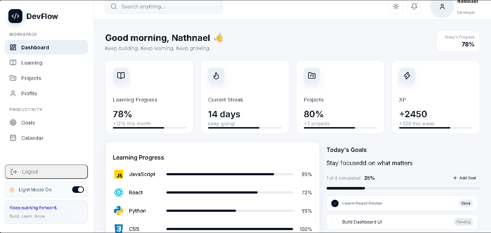

# 📊 Devflow

> A modern personal learning & development dashboard to track your coding journey, manage goals, and showcase your projects all in one place.



---

## 🎯 About Devflow

Devflow is a personalized dashboard I built to help myself (and hopefully you too!) keep track of everything related to learning web development. Whether you're juggling multiple courses, working on side projects, or trying to hit your goals – Devflow makes it easy to see your progress at a glance and stay motivated.

The inspiration came from wanting a central hub where I could:

- 📈 Track my learning progress across different tech stacks
- 🔥 Maintain consistent streaks to build discipline
- 📁 Showcase and organize all my projects
- 🎯 Set and monitor personal development goals
- 📅 Plan and schedule my learning activities
- ⚡ Gamify my learning with XP points

---

## ✨ Features

### 🏠 Dashboard

Get a quick overview of your learning journey with real-time stats:

- **Learning Progress** - See how far you've come this month
- **Current Streak** - Track your consistency (mine's at 14 days! 🔥)
- **Project Count** - Monitor how many projects you've completed
- **XP Earned** - Gamify your learning with experience points

### 📚 Learning

Stay organized with all your courses in one place:

- Multiple course tracking (JavaScript, React, Python, CSS, etc.)
- Progress bars for each course
- Lesson completion tracking
- Visual indicators for course status

### 💼 Projects

Showcase everything you've built:

- Project cards with descriptions
- Progress indicators
- Links to live projects and repositories
- Organized portfolio view

### 🎯 Goals

Keep yourself accountable:

- Set short-term and long-term goals
- Track completion status
- See how many goals you've achieved
- Stay motivated with visual progress

### 📅 Calendar & 👤 Profile

- **Calendar** - Plan your learning schedule and see what you've done
- **Profile** - Manage your personal info and preferences

---

## 🛠️ Tech Stack

This project was built with some solid modern technologies:

- **[React 19.2.8](https://react.dev/)** - The UI library (obviously!)
- **[Vite](https://vitejs.dev/)** - Lightning-fast build tool and dev server
- **[React Router v7](https://reactrouter.com/)** - For seamless page navigation
- **[Lucide React](https://lucide.dev/)** - Beautiful, consistent icons
- **[JavaScript](https://developer.mozilla.org/en-US/docs/Web/JavaScript)** - Core language
- **[ESLint](https://eslint.org/)** - Code quality and consistency

---

## 🚀 Getting Started

### Prerequisites

- Node.js (v14 or higher)
- npm or yarn

### Installation

1. **Clone the repository**

   ```bash
   git clone https://github.com/nathnaelashenafi/devflow.git
   cd devflow
   ```

2. **Install dependencies**

   ```bash
   npm install
   ```

3. **Start the development server**

   ```bash
   npm run dev
   ```

4. **Open in your browser**
   Navigate to `http://localhost:5173` (or whatever Vite tells you)

---

## 📁 Project Structure

```
devflow/
├── src/
│   ├── components/       # Reusable React components
│   ├── pages/           # Main page components
│   ├── layouts/         # Layout wrapper
│   ├── data/            # Sample data files
│   ├── assets/          # Images and icons
│   ├── App.jsx          # Main app component
│   └── main.jsx         # Entry point
├── public/
│   ├── projects/        # Project showcase files
│   └── preview.png      # Project preview image
├── package.json         # Dependencies
├── vite.config.js       # Vite configuration
└── README.md            # This file!
```

---

## 💻 Available Scripts

```bash
# Start development server
npm run dev

# Build for production
npm run build

# Preview production build
npm run preview

# Run linting
npm run lint
```

---

## 📸 Project Showcase

The `public/projects/` folder contains some of my other projects:

- **NexaAI** - An AI-powered learning assistant
- **Nexafit** - A fitness tracking application
- **Weather App** - A real-time weather dashboard

Feel free to check them out! They're all built with vanilla JavaScript and some modern styling.

---

## 🎓 What I Learned

Building Devflow taught me a lot about:

- Component architecture and reusability in React
- State management with hooks (`useState`, etc.)
- Client-side routing with React Router
- Responsive design principles
- Building a modern development workflow with Vite
- Writing clean, maintainable code

---

## 🔮 Future Ideas

I'm planning to add some cool features down the road:

- 🌐 Backend integration with a database
- 👥 Social features (share goals with friends, leaderboards)
- 📊 Advanced analytics and insights
- 🔔 Notifications and reminders
- 💾 Data persistence across sessions

---

## 📝 License

This project is open source and available under the MIT License. Feel free to use it for learning or inspiration!

---

## 👤 About Me

I'm Nathnael Ashenafi, a passionate developer and lifelong learner. This project is a reflection of my journey in web development and my commitment to continuous improvement.

### Let's Connect!

- **GitHub:** [@nathnaelashenafi](https://github.com/nathnaelashenafi)
- **Repository:** [devflow.git](https://github.com/nathnaelashenafi/devflow.git)

Feel free to star ⭐ this project if you find it helpful, and don't hesitate to open issues or suggest improvements!

---

## 🙏 Acknowledgments

Thanks to:

- The React and Vite communities for amazing tools
- Lucide for the beautiful icon library
- Everyone who's encouraged me on this learning journey

---

**Happy Learning! Keep Building. Keep Growing. 🚀**

_Last updated: August 2026_
